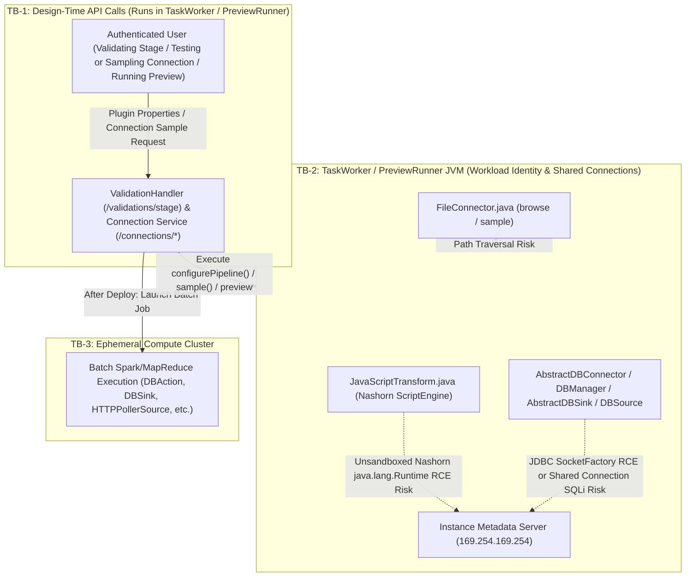

# Security Threat Model: Hydrator Core & Database Plugins (`cdapio/hydrator-plugins`)

**Scope:** `https://github.com/cdapio/hydrator-plugins` (branches `develop`, `release/*`)  
**Components:** `core-plugins`, `database-plugins`, `hydrator-common`, `transform-plugins`, `spark-plugins`, and coupled connector modules

---

## 1. Asset Definition & Scope

This threat model defines the trust boundaries, untrusted user-controlled inputs, runtime identities, known sink classes, and security invariants for **Hydrator Plugins** (`cdapio/hydrator-plugins`), which execute inside `TaskWorker` and `PreviewRunner` pods during design-time validation, connection testing, schema browsing, sampling, and preview, as well as on compute clusters during batch/streaming pipeline runs.

- **Core Transform, Action & File Connector Plugins (`core-plugins`, `transform-plugins`, `spark-plugins`)**:
  - Includes `JavaScriptTransform.java` (Nashorn JS evaluator), `PythonEvaluator.java`, `ValidatorTransform.java`, `FileConnector.java` (`browse`, `sample`), `FTPBatchSource.java`, `HTTPPollerSource.java`, `HTTPCallbackAction.java`, `SSHAction.java`, `EmailAction.java`, and `XMLParser.java` / `XMLRecordReader.java`.
- **Database Sources, Sinks, Actions & Connectors (`database-plugins`, `hydrator-common`)**:
  - Includes `AbstractDBConnector.java`, `DBManager.java`, `AbstractDBSink.java` (`validateSchema`), `AbstractDBSource.java`, `DBSource.java` (`getSchema`), `DBSink.java`, `DBAction.java`, `DBRun.java`, and database-specific connectors (`PostgresConnector`, `MySQLConnector`, `OracleConnector`, `MSSQLConnector`).

### Related Component Threat Models

- **CDAP Core Runtime (`cdapio/cdap`)**: `cdap/THREAT_MODEL.md`
- **CDAP Build & Packaging (`cdapio/cdap-build`)**: `cdap-build/THREAT_MODEL.md`
- **CDAP Web UI & Node.js Proxy (`cdapio/cdap-ui`)**: `cdap-ui/THREAT_MODEL.md`
- **CDAP Kubernetes Operator (`cdapio/cdap-operator`)**: `cdap-operator/THREAT_MODEL.md`
- **Wrangler Data Prep Service & Directives (`data-integrations/wrangler`)**: `wrangler/THREAT_MODEL.md`

---

## 2. Trust Boundaries & Runtime Identities

### 2.1 Trust Boundaries

- **TB-1 (Design-Time Validation, Preview & Shared Connection Boundary inside `TaskWorker` / `PreviewRunner`)**:
  - When a user calls `/validations/stage`, `/connections/{conn}/sample`, `/connections/{conn}/browse`, `/connections/{conn}/test`, or runs a Preview, plugin code executes **inside shared `TaskWorker` or `PreviewRunner` pods**, not on an isolated ephemeral job cluster.
  - Therefore, any plugin code reachable during `configurePipeline()`, `validateSchema()`, `getSchema()`, `test()`, `browse()`, `sample()`, or `transform()` (in Preview) crosses a critical trust boundary if it allows arbitrary Java code execution (Nashorn, JDBC `socketFactory`), local container file read (`FileConnector`), IMDS SSRF, or SQL injection against a pre-configured **shared Connection** whose credentials the caller does not own.
- **TB-2 (Nashorn Script Sandbox & ClassLoader Isolation in `PreviewRunner` / `TaskWorker`)**:
  - `JavaScriptTransform.java` evaluates user JavaScript during Preview inside `PreviewRunner`. Without `--no-java` and a deny-all `ClassFilter`, user JavaScript can invoke `Java.type('java.lang.Runtime').getRuntime().exec(...)` or query `169.254.169.254`.
- **TB-3 (Batch Compute Cluster Runtime vs. Design-Time Boundary)**:
  - During a batch pipeline run on an ephemeral compute cluster (`TB-3`), plugins like `DBAction`, `DBRun`, `HTTPPollerSource`, `FileSink`, and `XMLParser` intentionally execute user-configured SQL or HTTP requests against the user's external systems using stage-supplied credentials. Security controls must prioritize **design-time execution (`TB-1` / `TB-2`)** and **shared Connection isolation**.

---

## 3. Untrusted User-Controlled Inputs & Entry Points

| Entry Point | Classes / Methods | Untrusted User-Controlled Inputs | Required Validation & Guards |
|---|---|---|---|
| **JavaScript Transform (`core-plugins`)** | `JavaScriptTransform.java` (`initialize`, `transform`, `configurePipeline`) | `script` (user JavaScript code), `schema`, `lookup` config | Initialize Nashorn via `NashornScriptEngineFactory.getScriptEngine(new String[]{"--no-java"}, classLoader, clazz -> false)` so Java classes (`java.lang.Runtime`, `java.net.URL`, `java.io.File`) are inaccessible. |
| **JDBC Connectors, Sources & Sinks (`database-plugins`, `hydrator-common`)** | `AbstractDBConnector.java`, `DBManager.java`, `AbstractDBSink.java` (`validateSchema`), `DBSource.java` (`getSchema`), `*Connector.sample()` | `connectionString`, `connectionArguments`, JDBC `Properties` (`socketFactory`, `socketFactoryArg`, `sslfactory`, `autoDeserialize`, `allowLoadLocalInfile`, `INIT`), `tableName`, `schemaName`, `strata`, `path` | Strictly allowlist/sanitize JDBC connection properties; quote/validate SQL identifiers and parameterize queries in `validateSchema`, `getSchema`, and `Connector.sample`. |
| **File Connector (`core-plugins`)** | `FileConnector.java` (`browse`, `sample`, `generateSpec`) | `path`, file system properties, archive entries | Restrict local filesystem browsing inside `TaskWorker` containers; enforce canonical path confinement and reject symlinks during archive extraction. |

---

## 4. Known Sink Classes & Vulnerability Patterns in Scope

1. **Unsandboxed Nashorn JavaScript Execution**:
   - **Sinks**: `core-plugins/.../JavaScriptTransform.java` (`ScriptEngineManager.getEngineByName("nashorn")`).
   - **Mechanism**: Creating a default Nashorn `ScriptEngine` without `--no-java` and a deny-all `ClassFilter` allows user JavaScript in `PreviewRunner` or `TaskWorker` to access `java.lang.Runtime` and execute arbitrary OS commands.
2. **Arbitrary Code Execution via Unsanitized JDBC Connection Strings & Driver Properties**:
   - **Sinks**: `database-plugins/.../DBManager.java`, `hydrator-common/.../AbstractDBConnector.java`, and `*Connector.java` / `*Source.java` across `database-plugins`.
   - **Mechanism**: Passing user-supplied `connectionArguments` or raw JDBC URL query parameters directly to `DriverManager.getConnection` or `Driver.connect` in `TaskWorker` allows attackers to specify driver-level RCE gadgets such as PostgreSQL `socketFactory` / `socketFactoryArg` / `sslfactory`, MySQL `autoDeserialize` / `allowLoadLocalInfile`, or H2 `INIT=RUNSCRIPT`.
3. **SQL Injection in Design-Time Validation & Shared Connection Sampling**:
   - **Sinks**: `AbstractDBSink.validateSchema`, `DBSource.getSchema`, and `*Connector.sample()` (`strata` and `path` parameters).
   - **Mechanism**: Concatenating unvalidated `tableName`, `schemaName`, `strata`, or `path` strings into SQL statements executed inside `TaskWorker` during stage validation (`configurePipeline()`) or shared Connection sampling allows unauthorized SQL execution using the shared Connection's credentials.
4. **Path Traversal, Arbitrary File Read & Zip Slip in `FileConnector`**:
   - **Sinks**: `core-plugins/.../FileConnector.java` (`browse`, `sample`).
   - **Mechanism**: Browsing and sampling the local container filesystem of `TaskWorker` (`/proc/self/environ`, `/var/run/secrets/kubernetes.io/serviceaccount/token`, `/etc/passwd`) or extracting archives containing `../` or symbolic links.
5. **Disabled TLS/SSH Verification & Cleartext Secret Leakage**:
   - **Sinks**: `FTPBatchSource.java`, `SSHAction.java`, and `EmailAction.java`.

---

## 5. Core Security Invariants

1. **Invariant PLG-INV-01 (Strict Nashorn `--no-java` & `ClassFilter` Sandboxing)**: `JavaScriptTransform.java` MUST initialize Nashorn with `--no-java` and a `ClassFilter` that rejects all Java class resolution (`clazz -> false`), preventing any access to `java.lang.Runtime`, `java.lang.ProcessBuilder`, `java.io.*`, or `java.net.*`.
2. **Invariant PLG-INV-02 (JDBC Property Allowlisting & Parameterized Design-Time Queries)**: `AbstractDBConnector`, `DBManager`, and all database connectors MUST strip/reject dangerous JDBC driver properties (`socketFactory`, `socketFactoryArg`, `sslfactory`, `sslpasswordcallback`, `autoDeserialize`, `queryInterceptors`, `statementInterceptors`, `allowLoadLocalInfile`, `allowUrlInLocalInfile`, `INIT`), and MUST strictly quote identifiers and parameterize SQL queries in `validateSchema`, `getSchema`, `browse`, and `sample`.
3. **Invariant PLG-INV-03 (Container Filesystem Confinement in `FileConnector`)**: `FileConnector` MUST NOT permit browsing or sampling arbitrary container filesystem paths (`/proc`, `/sys`, `/var/run/secrets`, `/etc`, `/opt/cdap`) inside `TaskWorker`.
